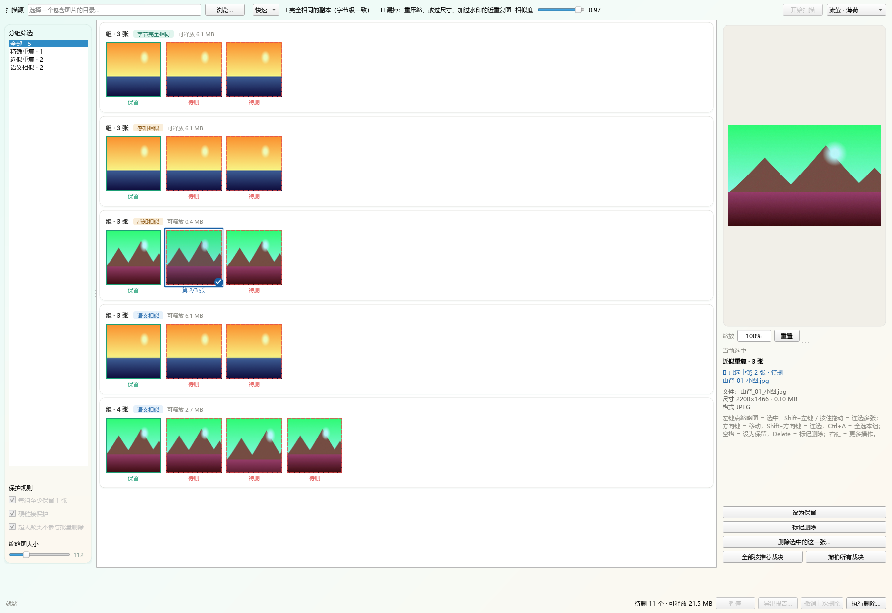

# ImgDedup

Windows 上的本地图片去重工具。找出字节完全相同的副本、缩放或重压缩过的近似图、以及同场景的语义相似图，把可疑分组连缩略图一起摆出来，由你逐组裁决。它不会自动删任何东西，删除只走回收站或你指定的目录，每次都写撤销记录。



**文档导航**

| 你是 | 看哪份 |
|---|---|
| 想装来用 | 就是这份 |
| 想自己打包发布 | 就是这份的「打包与发布」一节 |
| 要改这个仓库 | [docs/开发文档.md](docs/开发文档.md) |
| 想了解计划、约束与设计决策 | [PLAN.md](PLAN.md) |
| 要改主题配色 | [docs/流萤主题美化设计方案.md](docs/流萤主题美化设计方案.md) |
| 要发布二进制、或核对许可 | [THIRD_PARTY_NOTICES.md](THIRD_PARTY_NOTICES.md) |

## 它解决什么问题

图库攒久了，同一张图往往有好几份：微信存过一遍、截图存过一遍、相机导入又存了一遍。有的是原图，有的是发朋友圈前压过的，有的是裁掉水印的。按文件名找不到它们，按修改时间也找不到。

常见的工具分两类，都不太敢用：

- 只比哈希的，能找出字节完全一样的副本，但"压过的同一张图"一个都发现不了；
- 号称智能清理的，直接替你勾一堆待删项，甚至默认自动清理。图库这种东西删错一次就是不可逆的损失，没人敢按那个按钮。

ImgDedup 走第三条路：**扫描尽量全，删除必须由你决定**。它把差异摆出来，给个推荐保留项，你逐组确认；真正动手删除时，动作只走回收站或你指定的目录，并留下撤销记录。

## 三档扫描模式

工具栏里选档位。档位决定花多少算力、能发现什么。

| 档位 | 比什么 | 能发现 | 漏掉 | 代价 |
|---|---|---|---|---|
| 快速 | 文件大小 + 头尾各 64 KB 指纹（合计 128 KB） | 字节完全相同的副本 | 重压缩、改过尺寸、加过水印的图 | 秒级，CPU 只用来读几千字节 |
| 精确（默认） | 快速档 + 全量哈希 + 感知特征（pHash / dHash / 颜色直方图） | 上述全部，再加缩放、轻微调色、重编码后仍相似的图 | 构图相似但画面内容不同的图 | 每张图解码一次到 256 px |
| 深度 | 精确档 + CLIP 语义向量余弦聚类 | 上述全部，再加同场景、同主体的不同画面 | 语义模型自己理解不了的抽象相似 | 每张图多跑一次神经网络编码 |

工具栏里档位旁边常驻一行说明，写的就是"能抓到什么 / 会漏掉什么"，切档时跟着变。

「深度」档需要 CLIP 模型（见下面「两个外置组件」）。模型不在位时，你一切到这一档就会弹框问要不要现在下载；选「暂不下载」的话档位会**拨回你上一次选的那一档**，不会带着一个跑不了的档位开始扫描。

## 结果分四类

| 类型 | 含义 |
|---|---|
| 精确重复 | 字节级完全一致 |
| 近似重复 | 感知特征接近，通常是同一张图的缩放 / 调色 / 重编码版本 |
| 语义相似 | CLIP 余弦相似度超过阈值 |
| 聚类（过合并） | 连通分量规模超过上限，单独隔离，不参与批量删除 |

一个文件只会出现在其中**一类**里，按 精确 > 近似 > 语义 取最强的那类。
字节完全相同的图必然也满足"感知接近"，两类都报的话同一批文件要裁决两遍，
而且"可释放"会把它们算两遍。

## 安装

### 免安装版

1. 从 Releases 下 `ImgDedup-portable-win64.zip`，解压到任意目录；
2. 再下 `cv2-win64.zip`，解压后把里面的 `cv2` 文件夹放进 `ImgDedup.exe` 同级的 `extra\`（见下一节）；
3. 双击 `ImgDedup.exe`。

想核对下载有没有坏，可以对着 Release 里的 `SHA256SUMS.txt` 验一下校验和。

### 安装版

下 `ImgDedup-*-setup.exe` 双击安装。装到 `%LOCALAPPDATA%\Programs\ImgDedup`，开始菜单与桌面会有快捷方式，能在「设置 → 应用」里正常卸载。装的过程不弹 UAC，本工具不需要任何系统级权限。

### 从源码跑

```bash
pip install -r requirements.txt
python -m dev.fetch_model     # 可选，只有要用「深度」档才需要
python -m imgdedup_ui
```

开发机上 cv2 也可以直接 `pip install opencv-python`，省得往 `extra/` 里放。注意打包产物不带它，它是外置组件。

## 两个外置组件

为了让安装包不至于 300 MB 以上，这两个大件不随包分发，都要放在 `ImgDedup.exe` 同级的 `extra\` 下。PDF 与 AI 不需要外置组件，解码走随包的 pypdfium2，开箱即用。

### 1. cv2（86 MB）—— 扫描必需

解压 `cv2-win64.zip`，把里面的 `cv2` 文件夹整个放进去，让这个文件能被看到：

```
extra\cv2\cv2.pyd
```

### 2. CLIP 模型（85 MB）—— 只有「深度」档需要

解压 `models-*.zip`，把 `models` 文件夹放进去：

```
extra\models\Xenova__clip-vit-base-patch32\vision_model.onnx
```

### 懒得手动放

程序里会弹提示，对话框上有「自动下载」和「打开该文件夹」两个按钮。缺 cv2 在启动时就提示，缺模型只在切到「深度」档时提示。

## 怎么用

1. **选扫描源**：工具栏最左边选目录，子目录会一起扫。
2. **选档位**：快速 / 精确 / 深度。
3. **调阈值**：只有「深度」档用得上，默认 0.97。别往低调 —— 这个值必须按图库调，在作者本机的图库上 0.92 会把半个库合并成一个巨型组。
4. **开始**：底部是多段进度条，每个阶段一段；扫描期间可以暂停、可以取消。
5. **审阅**：中间网格按组展示，点缩略图切换「待删 / 未裁决」，右栏按钮设为保留。右栏上半是预览大图（滚轮缩放，最大 16 倍），下半是这张图的完整信息。
6. **过滤**：左栏可以只看某一类分组（单选）；左下角的滑块调缩略图大小（64–256 px）。
7. **执行删除**：底栏「执行删除…」。
8. **删错了**：底栏「撤销上次删除」。
9. **留档**：底栏「导出报告…」，HTML 给人看，CSV 给表格工具。

## 三条保护规则

左栏「保护规则」这三条默认开启，界面上不提供关闭入口：

- **每组至少保留 1 张**：任何一组都不可能被整组清空；
- **硬链接保护**：指向同一个 inode 的多个路径不算重复，不参与删除；
- **超大聚类不参与批量删除**：规模超过上限的连通分量被隔离出来，只能逐张人工确认。

另外，精确重复组在执行删除前会再逐字节确认一遍，哈希碰撞的风险在这里归零。

## 数据放在哪

| 位置 | 内容 |
|---|---|
| `%LOCALAPPDATA%\ImgDedup\cache\` | 指纹复用库与缩略图缓存。删掉不影响正确性，只是下次要重算 |
| `%LOCALAPPDATA%\ImgDedup\catalog.db` | 删除方式与目标目录的记忆（SQLite，WAL 模式）。扫描结果不落库 |
| `%LOCALAPPDATA%\ImgDedup\manifests\` | 每次删除写的撤销记录 |
| `%LOCALAPPDATA%\ImgDedup\theme.json` | 上次选的主题 |
| `<ImgDedup.exe 同级>\extra\` | 两个外置组件 |

## 卸载

用安装包装的走「设置 → 应用」正常卸载。卸载会连 `extra\` 一起删掉，避免留下一个 171 MB 的孤儿目录。你自己放了 cv2 或模型的话，卸载前先拷出来。

免安装版直接删目录就行。

## 常见问题

**启动就提示缺 cv2。** 扫描必需，装上才能用。对话框上有「自动下载」，也可以手动解压 `cv2-win64.zip`，放成 `extra\cv2\cv2.pyd` 即可。

**切到「深度」档提示缺模型。** 只有这一档需要它，快速与精确两档不需要。同样可以自动下载；不想下就把档位换回去。

**删掉的文件去哪了？** 默认在系统回收站；选过「移动到指定目录」的话就在那个目录里，原目录结构保留。

**撤销能还原到什么程度？** 底栏「撤销上次删除」按撤销记录还原，还原前校验哈希；目标位置已有同名文件时报冲突，不覆盖。

**十万张图会不会卡？** 网格用 Qt 原生虚拟化，只渲染可见行，控件数与图库规模无关。启动路径上也不导入核心引擎，所以窗口是秒开的。

**「快速」档找不到我明明重复的图。** 它只比文件大小和头尾各 64 KB 的指纹，重压缩过的图字节不同，它看不见。要抓这类图请用「精确」档。

## 第三方组件与许可

本仓库自己的代码是 [MIT](LICENSE)。打包产物里含第三方组件，其中 PySide6 与 libvips 是 LGPL-3.0，分发二进制时要附上许可全文，并保证用户可以替换这两个库。完整清单、版本、许可类型与分发义务见 [THIRD_PARTY_NOTICES.md](THIRD_PARTY_NOTICES.md)，**发布二进制前请先读它**。

PDF 与 AI 解码用 pypdfium2（BSD-3-Clause / Apache-2.0），随包分发。产物里没有 AGPL 组件。

## 系统要求

- Windows 10 / 11，64 位
- 不需要装 Python，免安装版与安装版都自带运行时

## 打包与发布

Release 页上挂着五个文件：安装包、免安装版 zip，加上两个外置组件的 zip 和一份
校验和。前两个是本工具本体，自己打包也只需要这两个。

前置：

```bash
pip install -r requirements-dev.txt       # 里面有 PyInstaller
winget install --id JRSoftware.InnoSetup  # 只有要编安装包才需要
```

打包前先把正在运行的 `ImgDedup.exe` 关掉。它锁着产物时，PyInstaller 的 COLLECT
可能产出一个新旧文件混在一起的目录。

四种跑法，按你要什么挑：

```bash
python -m dev.make_installer --build      # 两个形态都出：先免安装版，再安装包
python -m dev.make_installer --portable   # 只出免安装版，不编安装包
python -m dev.make_installer              # 只编安装包，要求免安装版已存在
python -m dev.make_installer --check      # 只体检已有产物，不重新编译
```

`--build` 与 `--portable` 互斥。每条路的退出码都是体检结论，0 才算过，所以脚本里
可以直接拿它当判据。

`--portable` 之后的体检只看免安装版那一半，不会因为「安装包不存在」判失败。
没装 Inno Setup 的机器上就用它验证免安装版。

| 形态 | 产物 | 怎么用 |
|---|---|---|
| 免安装版 | `dist\ImgDedup\` | 整个文件夹拷到哪都能跑，不写注册表 |
| 安装版 | `dist\installer\ImgDedup-<版本>-setup.exe` | 双击安装，能在「应用和功能」里卸载 |

版本号读的是 `imgdedup_core/__init__.py` 里的 `__version__`，改版本只改那一处。

`--check` 只看图标嵌进去没有、体积对不对。要更实一层，拿
`python dev/check_artifacts.py` 跑一遍产物自检：它会启动 exe、核对缺 cv2 与缺模型时
的提示、扫包里有没有混进 AGPL 组件。

两个会绊人的地方：

`--build` 内部带 `--clean` 重跑 PyInstaller，`dist\ImgDedup\extra\` 跟着被清掉重建。
你之前把 cv2 放进去了的话，得再放一次。

免安装版的 zip 和 `SHA256SUMS.txt` **不是这个脚本产的**。它们由
[.github/workflows/release.yml](.github/workflows/release.yml) 在发版时生成；
本地想自己压，把 `dist\ImgDedup\` 压成 zip 就行。

发版不用打标签：改掉 `imgdedup_core/__init__.py` 里的 `__version__`、推上
`master` 就行。release.yml 会跑测试、打包、下载两个外置组件、算校验和，
按版本号建出 `v<版本>` 标签，再把五个文件挂到 Release 上。
本机不需要装 Inno Setup。

版本号没动的话这一步会跳过。一个版本号只发一次，否则同一个 `1.0.0`
会对应上两份不同的二进制，`SHA256SUMS.txt` 也就没意义了。
想重发同一个版本，去 Actions 页手动跑一次 Release workflow 即可。

## 参与开发

```bash
pip install -r requirements-dev.txt
python -m unittest discover -s tests -p "test_*.py"
python dev/check_no_network.py      # 门禁：确认没有会偷偷联网的代码路径
python dev/check_fresh_clone.py     # 门禁：按 git 的口径在干净副本里再跑一遍
python -m dev.make_installer --build
```

提交前过一遍 [.github/pull_request_template.md](.github/pull_request_template.md) 的自查清单。
踩过的坑、编码约定、质量门禁和常见改动怎么做，都在
[docs/开发文档.md](docs/开发文档.md) —— **动手之前值得看一遍**，尤其是第 9、10 两节。
